# Jarkom-Modul-4-2026-K-47
| No | Nama | NRP |
|:---:|---|---|
| 1 | Elisabeth La Satta Sitorus | 5027251039 |
| 2 | Farrel Muhammad Athasyah Enrizy | 5027251100 |

**VLSM**

**CIDR - Cisco Packet Tracker (Elisabeth)**

## Topologi Jaringan
### Cisco Packet Tracer
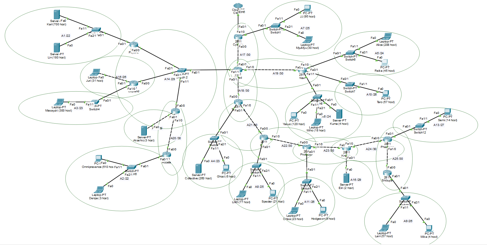

- **Prefix Kelompok:** `10.87.x.x`
- **Router Utama (Core):** Wired — sebagai persimpangan utama yang menghubungkan seluruh cabang
- **Cabang Kiri:** Psyche → Copland / Schumann → Accela
- **Cabang Kanan:** Navi (dengan subnet klien yang besar)
- **Cabang Bawah:** Tachibana → Deus → Protocol7 → Knights → Phantoma → Shibuya

## Pembagian Subnet (Subnetting) CIDR
Subnetting dengan metode CIDR dilakukan **bottom-up** — mulai dari subnet terkecil di ujung topologi, kemudian digabungkan ke atas hingga mendapatkan satu blok besar (supernet).
### Proses Penggabungan (Supernet)
Berikut adalah tahapan penggabungan subnet secara bertahap:
#### Tahap 1 — Penggabungan Awal
.png)

#### Tahap 2 — Penggabungan Lanjutan
.png)

#### Tahap 3
.png

#### Tahap 4
.png)

#### Tahap 5 — Supernet Final
.png)

#### Tabel Supernet
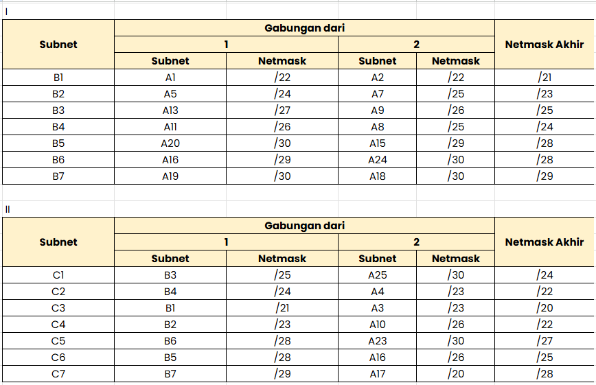  
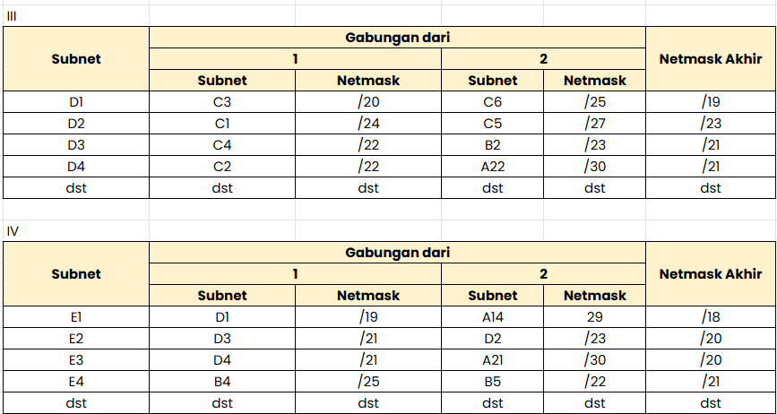  
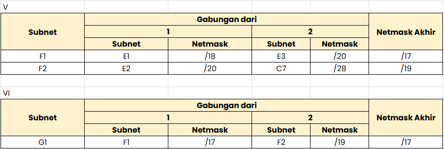


## Tree Pembagian IP

Tree di atas menunjukkan hierarki pembagian IP address dari supernet terbesar hingga subnet terkecil. Setiap cabang merepresentasikan satu langkah pemecahan (splitting) subnet menjadi dua bagian yang lebih kecil.

## Tabel Pembagian IP Address
Berikut adalah hasil akhir pembagian IP address untuk seluruh subnet dalam topologi:
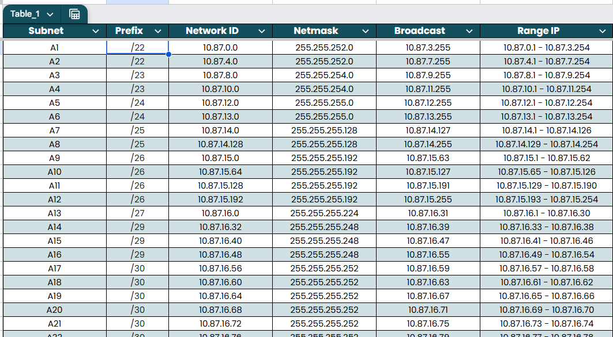

### Subnet Klien (Host Networks)
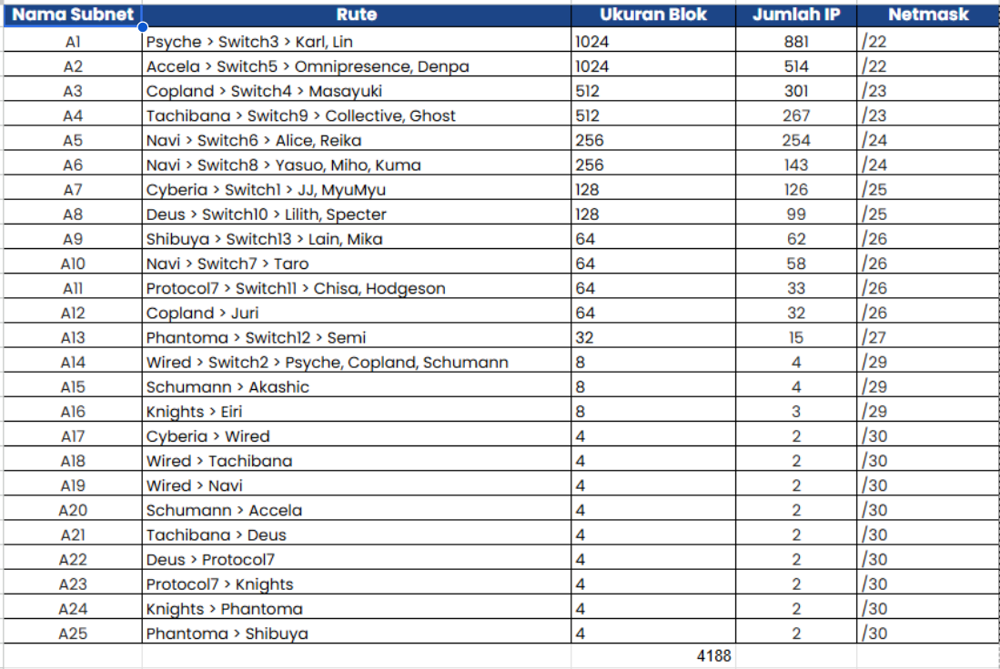

## Konfigurasi IP Address (IP Route)
### Cisco Packet Tracer (CPT)
Konfigurasi dilakukan menggunakan **Cisco IOS CLI** pada masing-masing router. Routing menggunakan **OSPF (Open Shortest Path First)** dengan area 0.
> **Format Konfigurasi:**
> ```
> enable
> configure terminal
> interface <interface>
> ip address <IP> <netmask>
> no shutdown
> exit
> router ospf 1
> network 10.87.0.0 0.0.255.255 area 0
> end
> wr
> ```
#### Router Cyberia (Cabang Atas-Kiri)
```bash
enable
configure terminal
interface FastEthernet0/0
 no ip address
 ip address 10.87.16.57 255.255.255.252
 no shutdown
interface FastEthernet0/1
 no ip address
 ip address 10.87.14.1 255.255.255.128
 no shutdown
exit
router ospf 1
 no network 10.47.0.0 0.0.255.255 area 0
 network 10.87.0.0 0.0.255.255 area 0
end
wr
```
#### Router Wired (Core / Persimpangan Utama)
```bash
enable
configure terminal
interface FastEthernet0/0
 no ip address
 ip address 10.87.16.58 255.255.255.252
 no shutdown
interface FastEthernet0/1
 no ip address
 ip address 10.87.16.61 255.255.255.252
 no shutdown
interface FastEthernet1/0
 no ip address
 ip address 10.87.16.65 255.255.255.252
 no shutdown
interface FastEthernet1/1
 no ip address
 ip address 10.87.16.33 255.255.255.248
 no shutdown
exit
router ospf 1
 no network 10.47.0.0 0.0.255.255 area 0
 network 10.87.0.0 0.0.255.255 area 0
end
wr
```
#### Router Navi (Cabang Kanan)
```bash
enable
configure terminal
interface FastEthernet0/0
 no ip address
 ip address 10.87.16.66 255.255.255.252
 no shutdown
interface FastEthernet0/1
 no ip address
 ip address 10.87.12.1 255.255.255.0
 no shutdown
interface FastEthernet1/0
 no ip address
 ip address 10.87.13.1 255.255.255.0
 no shutdown
interface FastEthernet1/1
 no ip address
 ip address 10.87.15.65 255.255.255.192
 no shutdown
exit
router ospf 1
 no network 10.47.0.0 0.0.255.255 area 0
 network 10.87.0.0 0.0.255.255 area 0
end
wr
```
#### Router Psyche (Cabang Kiri)
```bash
enable
configure terminal
interface FastEthernet0/0
 no ip address
 ip address 10.87.0.1 255.255.252.0
 no shutdown
interface FastEthernet0/1
 no ip address
 ip address 10.87.16.34 255.255.255.248
 no shutdown
exit
router ospf 1
 no network 10.47.0.0 0.0.255.255 area 0
 network 10.87.0.0 0.0.255.255 area 0
end
wr
```
#### Router Copland (Cabang Kiri)
```bash
enable
configure terminal
interface FastEthernet0/0
 no ip address
 ip address 10.87.16.35 255.255.255.248
 no shutdown
interface FastEthernet0/1
 no ip address
 ip address 10.87.8.1 255.255.254.0
 no shutdown
interface FastEthernet1/0
 no ip address
 ip address 10.87.15.193 255.255.255.192
 no shutdown
exit
router ospf 1
 no network 10.47.0.0 0.0.255.255 area 0
 network 10.87.0.0 0.0.255.255 area 0
end
wr
```
#### Router Schumann (Cabang Kiri-Tengah)
```bash
enable
configure terminal
interface FastEthernet0/0
 no ip address
 ip address 10.87.16.36 255.255.255.248
 no shutdown
interface FastEthernet0/1
 no ip address
 ip address 10.87.16.41 255.255.255.248
 no shutdown
interface FastEthernet1/0
 no ip address
 ip address 10.87.16.69 255.255.255.252
 no shutdown
exit
router ospf 1
 no network 10.47.0.0 0.0.255.255 area 0
 network 10.87.0.0 0.0.255.255 area 0
end
wr
```
#### Router Accela (Ujung Kiri)
```bash
enable
configure terminal
interface FastEthernet0/0
 no ip address
 ip address 10.87.16.70 255.255.255.252
 no shutdown
interface FastEthernet0/1
 no ip address
 ip address 10.87.4.1 255.255.252.0
 no shutdown
exit
router ospf 1
 no network 10.47.0.0 0.0.255.255 area 0
 network 10.87.0.0 0.0.255.255 area 0
end
wr
```
#### Router Tachibana (Cabang Bawah)
```bash
enable
configure terminal
interface FastEthernet0/0
 no ip address
 ip address 10.87.16.62 255.255.255.252
 no shutdown
interface FastEthernet0/1
 no ip address
 ip address 10.87.10.1 255.255.254.0
 no shutdown
interface FastEthernet1/0
 no ip address
 ip address 10.87.16.73 255.255.255.252
 no shutdown
exit
router ospf 1
 no network 10.47.0.0 0.0.255.255 area 0
 network 10.87.0.0 0.0.255.255 area 0
end
wr
```
#### Router Deus (Cabang Bawah)
```bash
enable
configure terminal
interface FastEthernet0/0
 no ip address
 ip address 10.87.16.74 255.255.255.252
 no shutdown
interface FastEthernet0/1
 no ip address
 ip address 10.87.14.129 255.255.255.128
 no shutdown
interface FastEthernet1/0
 no ip address
 ip address 10.87.16.77 255.255.255.252
 no shutdown
exit
router ospf 1
 no network 10.47.0.0 0.0.255.255 area 0
 network 10.87.0.0 0.0.255.255 area 0
end
wr
```
#### Router Protocol7 (Cabang Bawah)
```bash
enable
configure terminal
interface FastEthernet0/0
 no ip address
 ip address 10.87.16.78 255.255.255.252
 no shutdown
interface FastEthernet0/1
 no ip address
 ip address 10.87.16.81 255.255.255.252
 no shutdown
interface FastEthernet1/0
 no ip address
 ip address 10.87.15.129 255.255.255.192
 no shutdown
exit
router ospf 1
 no network 10.47.0.0 0.0.255.255 area 0
 network 10.87.0.0 0.0.255.255 area 0
end
wr
```
#### Router Knights (Cabang Bawah)
```bash
enable
configure terminal
interface FastEthernet0/0
 no ip address
 ip address 10.87.16.82 255.255.255.252
 no shutdown
interface FastEthernet0/1
 no ip address
 ip address 10.87.16.49 255.255.255.248
 no shutdown
interface FastEthernet1/0
 no ip address
 ip address 10.87.16.85 255.255.255.252
 no shutdown
exit
router ospf 1
 no network 10.47.0.0 0.0.255.255 area 0
 network 10.87.0.0 0.0.255.255 area 0
end
wr
```
#### Router Phantoma (Cabang Bawah)
```bash
enable
configure terminal
interface FastEthernet0/0
 no ip address
 ip address 10.87.16.86 255.255.255.252
 no shutdown
interface FastEthernet0/1
 no ip address
 ip address 10.87.16.89 255.255.255.252
 no shutdown
interface FastEthernet1/0
 no ip address
 ip address 10.87.16.1 255.255.255.224
 no shutdown
exit
router ospf 1
 no network 10.47.0.0 0.0.255.255 area 0
 network 10.87.0.0 0.0.255.255 area 0
end
wr
```
#### Router Shibuya (Ujung Bawah)
```bash
enable
configure terminal
interface FastEthernet0/0
 no ip address
 ip address 10.87.16.90 255.255.255.252
 no shutdown
interface FastEthernet0/1
 no ip address
 ip address 10.87.15.1 255.255.255.192
 no shutdown
exit
router ospf 1
 no network 10.47.0.0 0.0.255.255 area 0
 network 10.87.0.0 0.0.255.255 area 0
end
wr
```
---
### GNS3
Pada GNS3, konfigurasi dibagi menjadi dua bagian:
1. **Konfigurasi Interface** (`/etc/network/interfaces`) — untuk setiap node
2. **Konfigurasi Routing** (`ip route`) — dijalankan sebagai script bash
#### Konfigurasi Interface Router
> Format: file `interfaces` di `/etc/network/interfaces`
**Router Cyberia** (Gateway ke Internet via NAT/DHCP)
```bash
auto eth0
iface eth0 inet dhcp         # Ke NAT / Internet
auto eth1
iface eth1 inet static
    address 10.87.14.1
    netmask 255.255.255.128  # Subnet Lain dkk
auto eth2
iface eth2 inet static
    address 10.87.16.57
    netmask 255.255.255.252  # Link ke Wired
```
**Router Wired** (Core Router)
```bash
auto eth0
iface eth0 inet static
    address 10.87.16.58
    netmask 255.255.255.252  # Link ke Cyberia
auto eth1
iface eth1 inet static
    address 10.87.16.49
    netmask 255.255.255.248  # Link ke cabang kiri (switch /29)
auto eth2
iface eth2 inet static
    address 10.87.16.61
    netmask 255.255.255.252  # Link ke Tachibana
auto eth3
iface eth3 inet static
    address 10.87.16.65
    netmask 255.255.255.252  # Link ke Navi
```
**Router Navi**
```bash
auto eth0
iface eth0 inet static
    address 10.87.16.66
    netmask 255.255.255.252  # Link ke Wired
auto eth1
iface eth1 inet static
    address 10.87.12.1
    netmask 255.255.255.0    # Subnet Alice dkk
auto eth2
iface eth2 inet static
    address 10.87.15.65
    netmask 255.255.255.192  # Subnet Semi dkk
auto eth3
iface eth3 inet static
    address 10.87.13.1
    netmask 255.255.255.0    # Subnet Miho dkk
```
**Router Tachibana**
```bash
auto eth0
iface eth0 inet static
    address 10.87.16.62
    netmask 255.255.255.252  # Link ke Wired
auto eth1
iface eth1 inet static
    address 10.87.10.1
    netmask 255.255.254.0    # Subnet JJ dkk
auto eth2
iface eth2 inet static
    address 10.87.16.73
    netmask 255.255.255.252  # Link ke Deus
```
**Router Psyche**
```bash
auto eth0
iface eth0 inet static
    address 10.87.16.50
    netmask 255.255.255.248  # Link ke switch /29
auto eth1
iface eth1 inet static
    address 10.87.0.1
    netmask 255.255.252.0    # Subnet Karl dkk
```
**Router Copland**
```bash
auto eth0
iface eth0 inet static
    address 10.87.15.129
    netmask 255.255.255.192  # Subnet Specter dkk
auto eth1
iface eth1 inet static
    address 10.87.16.51
    netmask 255.255.255.248  # Link ke switch /29
auto eth2
iface eth2 inet static
    address 10.87.8.1
    netmask 255.255.254.0    # Subnet Reika dkk
```
#### Konfigurasi Routing (ip route)
Konfigurasi routing lengkap dijalankan melalui script bash berikut:
**Router Cyberia** (Core + NAT)
```bash
# Aktifkan IP Forwarding
sysctl -w net.ipv4.ip_forward=1
# Konfigurasi NAT (Masquerade) ke arah Internet (NAT1) di eth0
iptables -t nat -A POSTROUTING -o eth0 -j MASQUERADE
# Routing melempar seluruh trafik lokal ke router Wired
ip route add 10.87.0.0/16 via 10.87.16.58
```
**Router Wired** (Core Routing)
```bash
sysctl -w net.ipv4.ip_forward=1
# Rute default ke atas (menuju Cyberia)
ip route add 0.0.0.0/0 via 10.87.16.57
# Rute ke Cabang Kiri
ip route add 10.87.0.0/22  via 10.87.16.50   # Psyche → Karl dkk
ip route add 10.87.8.0/23  via 10.87.16.51   # Copland → Reika dkk
ip route add 10.87.15.128/26 via 10.87.16.51 # Copland → Specter dkk
ip route add 10.87.4.0/22  via 10.87.16.52   # Schumann/Accela
ip route add 10.87.16.32/29 via 10.87.16.52  # Switch cabang kiri
# Rute ke Cabang Kanan (Navi)
ip route add 10.87.12.0/24  via 10.87.16.66  # Navi → Alice dkk
ip route add 10.87.13.0/24  via 10.87.16.66  # Navi → Miho dkk
ip route add 10.87.15.64/26 via 10.87.16.66  # Navi → Semi dkk
# Rute ke Cabang Bawah (Tachibana dan seterusnya)
ip route add 10.87.10.0/23   via 10.87.16.62  # Tachibana → JJ dkk
ip route add 10.87.14.128/25 via 10.87.16.62  # Deus → Chisa dkk
ip route add 10.87.15.192/26 via 10.87.16.62  # Protocol7
ip route add 10.87.16.40/29  via 10.87.16.62  # Knights switch
ip route add 10.87.16.0/27   via 10.87.16.62  # Phantoma → Mika dkk
ip route add 10.87.15.0/26   via 10.87.16.62  # Shibuya → Lin dkk
```
**Router Cabang Kiri (Psyche, Copland, Schumann, Accela)**
```bash
# --- PSYCHE ---
sysctl -w net.ipv4.ip_forward=1
ip route add 0.0.0.0/0 via 10.87.16.49       # Default ke Wired
# --- COPLAND ---
sysctl -w net.ipv4.ip_forward=1
ip route add 0.0.0.0/0 via 10.87.16.49       # Default ke Wired
# --- SCHUMANN ---
sysctl -w net.ipv4.ip_forward=1
ip route add 0.0.0.0/0 via 10.87.16.49       # Default ke Wired
ip route add 10.87.4.0/22 via 10.87.16.70    # Rute ke Accela
# --- ACCELA ---
sysctl -w net.ipv4.ip_forward=1
ip route add 0.0.0.0/0 via 10.87.16.69       # Default ke Schumann
```
**Router Cabang Kanan (Navi)**
```bash
# --- NAVI ---
sysctl -w net.ipv4.ip_forward=1
ip route add 0.0.0.0/0 via 10.87.16.65       # Default ke Wired
```
**Router Cabang Bawah (Tachibana → Shibuya)**
```bash
# --- TACHIBANA ---
sysctl -w net.ipv4.ip_forward=1
ip route add 0.0.0.0/0 via 10.87.16.61
ip route add 10.87.14.128/25 via 10.87.16.74  # → Deus
ip route add 10.87.15.192/26 via 10.87.16.74
ip route add 10.87.16.40/29  via 10.87.16.74
ip route add 10.87.16.0/27   via 10.87.16.74
ip route add 10.87.15.0/26   via 10.87.16.74
# --- DEUS ---
sysctl -w net.ipv4.ip_forward=1
ip route add 0.0.0.0/0 via 10.87.16.73
ip route add 10.87.15.192/26 via 10.87.16.78  # → Protocol7
ip route add 10.87.16.40/29  via 10.87.16.78
ip route add 10.87.16.0/27   via 10.87.16.78
ip route add 10.87.15.0/26   via 10.87.16.78
# --- PROTOCOL7 ---
sysctl -w net.ipv4.ip_forward=1
ip route add 0.0.0.0/0 via 10.87.16.77
ip route add 10.87.16.40/29 via 10.87.16.82   # → Knights
ip route add 10.87.16.0/27  via 10.87.16.82
ip route add 10.87.15.0/26  via 10.87.16.82
# --- KNIGHTS ---
sysctl -w net.ipv4.ip_forward=1
ip route add 0.0.0.0/0 via 10.87.16.81
ip route add 10.87.16.0/27 via 10.87.16.86    # → Phantoma
ip route add 10.87.15.0/26 via 10.87.16.86
# --- PHANTOMA ---
sysctl -w net.ipv4.ip_forward=1
ip route add 0.0.0.0/0 via 10.87.16.85
ip route add 10.87.15.0/26 via 10.87.16.90    # → Shibuya
# --- SHIBUYA ---
sysctl -w net.ipv4.ip_forward=1
ip route add 0.0.0.0/0 via 10.87.16.89
```
#### Konfigurasi PC/Host Klien
Setiap PC klien dikonfigurasi dengan format:
```bash
auto eth0
iface eth0 inet static
    address <IP_Host>
    netmask <Subnet_Mask>
    gateway <IP_Router_terdekat>
```
Contoh:
```bash
# PC Karl (subnet 10.87.0.0/22, gateway Psyche)
auto eth0
iface eth0 inet static
    address 10.87.0.2
    netmask 255.255.252.0
    gateway 10.87.0.1
```
---
## Hasil Tes Ping
Setelah semua konfigurasi IP address dan routing selesai, dilakukan pengujian konektivitas antar node dengan perintah `ping`.
### Cisco Packet Tracer
#### Hasil Ping 1
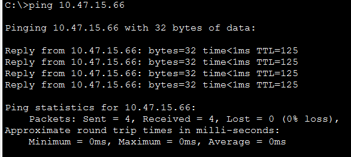
#### Hasil Ping 2
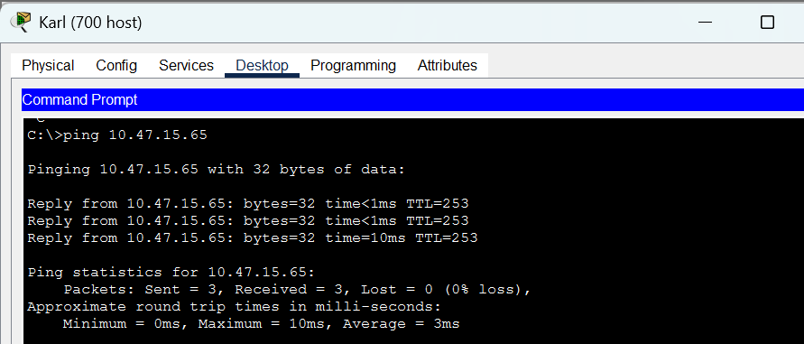
#### Hasil Ping 3
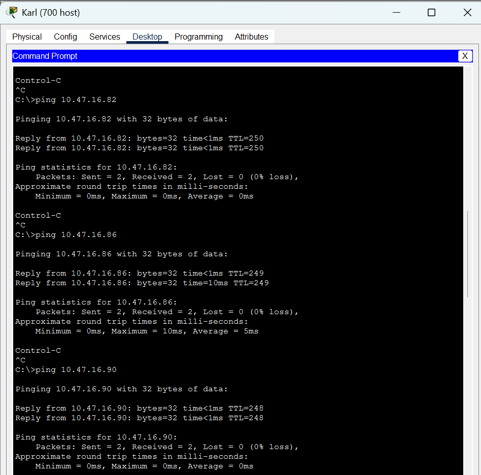
#### Hasil Ping 4
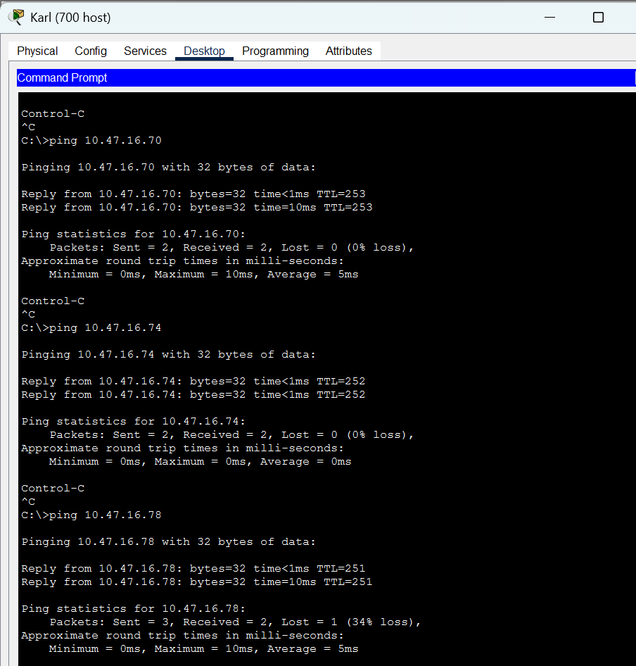
#### Hasil Ping 5
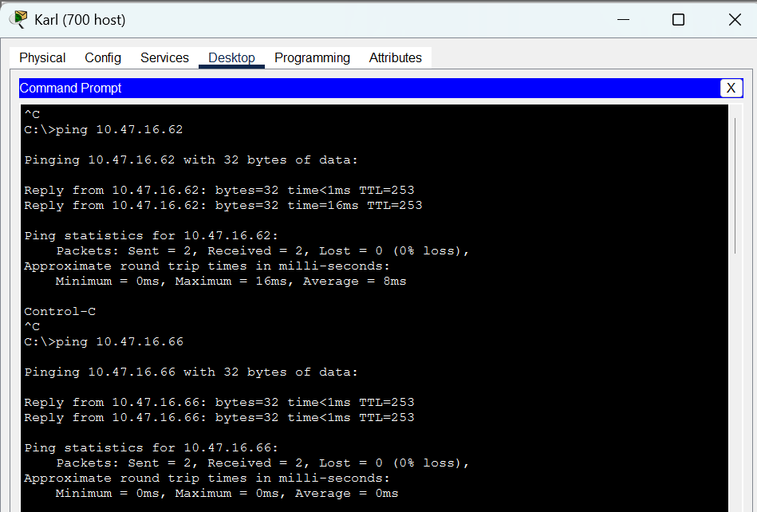

Semua node berhasil saling terhubung yang ditandai dengan respons `ping` yang sukses (0% packet loss).
